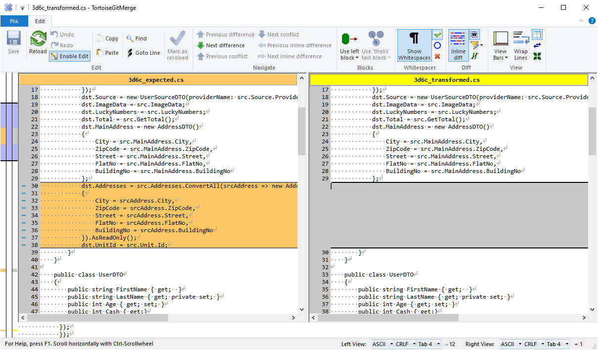

# RoslynTestKit

<!-- Status -->


<!-- Distribution -->
[](https://www.nuget.org/packages/ALCops.RoslynTestKit/)
[](https://www.nuget.org/packages/ALCops.RoslynTestKit/)

<!-- Metadata -->


A lightweight framework for writing unit tests for Roslyn diagnostic analyzers, code fixes, refactorings, and completion providers targeting the [AL Language](https://learn.microsoft.com/en-us/dynamics365/business-central/dev-itpro/developer/devenv-programming-in-al) of Microsoft Dynamics 365 Business Central. This project is a fork of [RoslynTestKit](https://github.com/cezarypiatek/RoslynTestKit), created to support the specific CodeAnalysis assemblies required by the AL language.

|CSharp|AL|
|--|--|
|Microsoft.CodeAnalysis|Microsoft.Dynamics.Nav.CodeAnalysis|
|Microsoft.CodeAnalysis.CodeActions|Microsoft.Dynamics.Nav.CodeAnalysis.CodeActions|
|Microsoft.CodeAnalysis.CodeFixes|Microsoft.Dynamics.Nav.CodeAnalysis.CodeFixes|
|Microsoft.CodeAnalysis.CodeRefactorings|Microsoft.Dynamics.Nav.CodeAnalysis.CodeRefactoring|
|Microsoft.CodeAnalysis.Completion|Microsoft.Dynamics.Nav.CodeAnalysis.Workspaces.Completion|
|Microsoft.CodeAnalysis.Diagnostics|Microsoft.Dynamics.Nav.CodeAnalysis.Diagnostics|
|Microsoft.CodeAnalysis.Text|Microsoft.Dynamics.Nav.CodeAnalysis.Text|
||Microsoft.Dynamics.Nav.CodeAnalysis.Workspaces.dll|


### Quick Start

1. Install the [ALCops.RoslynTestKit](https://www.nuget.org/packages/ALCops.RoslynTestKit/) package from NuGet into your project.
2. Create appropriate test fixture using `RoslynFixtureFactory`.
3. Configure the fixture to perform assertions.

### Dependencies

This is a minimal test project setup example with `NUnit` and the `RoslynTestKit`. We need minimal target `net8.0` and depedencies to `Microsoft.Dynamics.Nav.CodeAnalysis.dll` and `Microsoft.Dynamics.Nav.CodeAnalysis.Workspaces.dll`. 

```xml
<Project Sdk="Microsoft.NET.Sdk">
    <PropertyGroup>
        <TargetFramework>net8.0</TargetFramework>
    </PropertyGroup>
    <ItemGroup>
        <PackageReference Include="ALCops.RoslynTestKit" Version="1.0.0" />
        <PackageReference Include="Microsoft.CodeAnalysis.Common" Version="4.14.0" />
        <PackageReference Include="Microsoft.CodeAnalysis.CSharp" Version="4.14.0" />
        <PackageReference Include="Microsoft.NET.Test.Sdk" Version="17.10.0" />
        <PackageReference Include="NUnit" Version="4.1.0" />
        <PackageReference Include="NUnit3TestAdapter" Version="4.5.0" />
        <PackageReference Include="NUnit.Analyzers" Version="4.2.0" />
        <PackageReference Include="System.Collections.Immutable" Version="8.0.0" />
        <Using Include="NUnit.Framework" />
    </ItemGroup>
    <ItemGroup>
        <ProjectReference Include="src/MyCodeAnalyzer.csproj" />
    </ItemGroup>
    <ItemGroup>
        <Reference Include="Microsoft.Dynamics.Nav.CodeAnalysis">
            <SpecificVersion>False</SpecificVersion>
            <HintPath>myFolder/Microsoft.Dynamics.Nav.CodeAnalysis.dll</HintPath>
            <Private>True</Private>
        </Reference>
        <Reference Include="Microsoft.Dynamics.Nav.CodeAnalysis.Workspaces">
            <SpecificVersion>False</SpecificVersion>
            <HintPath>myFolder/Microsoft.Dynamics.Nav.CodeAnalysis.Workspaces.dll</HintPath>
            <Private>True</Private>
        </Reference>
    </ItemGroup>
</Project>
```

### Code location markers

RoslynTestKit accepts strings that are marked up with ```[|``` and ```|]``` to identify a particular span. This could represent the span of an expected diagnostic or the text selection before a refactoring is applied. 
Instead of the markers you can also provide line number to locate the place of expected diagnostic.

### Example: Test presence of a diagnostic

Create a `FlowFieldEditable.al` file which the AL compiler can parse and apply the code location markers.

##### FlowFieldEditable.al

```AL
table 50100 MyTable
{
    fields
    {
        field(1; MyField; Integer) { }
        [|field(2; MyCalcField; Boolean)|]
        {
            FieldClass = FlowField;
            CalcFormula = exist(MyTable where (MyField = field(MyField)));
        }
    }
}
```

Create a C# class to execute the tests. It's best practice to always use the `HasDiagnosticAtAllMarkers` method, especially when one of the `.al` files contain multiple markers.

```C#
[Test]
[TestCase("FlowFieldEditable")]
[TestCase("FlowFieldEditableWithoutComment")]
...
[TestCase("n")]
public async Task HasDiagnostic(string testCase)
{
    var code = await File.ReadAllTextAsync($"{testCase}.al").ConfigureAwait(false);
    var fixture = RoslynFixtureFactory.Create<MyCodeAnalyzer.Rules.FlowFieldsShouldNotBeEditable>();
    fixture.HasDiagnosticAtAllMarkers(code, DiagnosticIds.FlowFieldsShouldNotBeEditable);
}
```

### Example: Test absence of a diagnostic

Create a `FlowFieldObsoleteRemoved.al` file which the AL compiler can parse and apply the code location markers.

##### FlowFieldObsoleteRemoved.al

```AL
table 50100 MyTable
{
    fields
    {
        field(1; MyField; Integer) { }
        [|field(2; MyCalcField; Boolean)|]
        {
            FieldClass = FlowField;
            CalcFormula = exist(MyTable where (MyField = field(MyField)));
            ObsoleteState = Removed;
        }
    }
}
```

Create a C# class to execute the tests. It's best practice to always use the `NoDiagnosticAtAllMarkers` method, especially when one of the `.al` files contain multiple markers.

```C#
[Test]
[TestCase("FlowFieldObsoleteRemoved")]
[TestCase("FlowFieldTableObsoleteRemoved")]
...
[TestCase("n")]
public async Task NoDiagnostic(string testCase)
{
    var code = await File.ReadAllTextAsync($"{testCase}.al").ConfigureAwait(false);
    var fixture = RoslynFixtureFactory.Create<Analyzer.FlowFieldsShouldNotBeEditable>();
    fixture.NoDiagnosticAtAllMarkers(code, DiagnosticIds.FlowFieldsShouldNotBeEditable);
}
```

#### Example: Test code fix behavior

Create two files: `current.al` and `expected.al`.
Place the diagnostic marker in the `current.al` and in `expected.al` define the expected result without the markers.

##### current.al

```AL
table 50100 MyTable
{
    fields
    {
        field(1; MyField; Integer) { }
        [|field(2; MyCalcField; Boolean)|]
        {
            FieldClass = FlowField;
            CalcFormula = exist(MyTable where (MyField = field(MyField)));
        }
    }
}

```

##### expected.al

```AL
table 50100 MyTable
{
    fields
    {
        field(1; MyField; Integer) { }
        field(2; MyCalcField; Boolean)
        {
            FieldClass = FlowField;
            CalcFormula = exist(MyTable where (MyField = field(MyField)));
            Editable = false;
        }
    }
}

```

Create a C# class to execute the tests.

```C#
[Test]
[TestCase("SingleFlowFieldIsEditable")]
public async Task HasFix(string testCase)
{
    var currentCode = await File.ReadAllTextAsync("current.al").ConfigureAwait(false);
    var currentCode = await File.ReadAllTextAsync("expected.al").ConfigureAwait(false);

    var fixture = RoslynFixtureFactory.Create<FlowFieldsShouldNotBeEditableCodeFixProvider>(
        new CodeFixTestFixtureConfig
        {
            AdditionalAnalyzers = [new Analyzer.FlowFieldsShouldNotBeEditable()]
        });

    fixture.TestCodeFix(currentCode, expectedCode, DiagnosticDescriptors.FlowFieldsShouldNotBeEditable);
}
```

`TestCodeFix` and `NoCodeFix` build the `CodeFixContext` the way the AL editor does: `context.Diagnostics` holds the located diagnostic plus every other reported diagnostic on exactly the same span whose ID is in the provider's `FixableDiagnosticIds`, ordered by descending severity (the located diagnostic stays first among equal severities). A provider that reads only `context.Diagnostics[0]` therefore fails a test where two diagnostics share a span, as it would in the editor. When the descriptor overloads find no reported diagnostic at the marker, the context holds only the diagnostic created from the descriptor.

#### Example: Test FixAll behavior

FixAll tests verify that all diagnostics from a given rule can be fixed simultaneously using the CodeFix's `FixAllProvider`. This catches a class of bugs where individual fixes work fine, but applying all fixes at once fails due to overlapping text changes.

Create two files: `current.al` with `[| |]` markers at **every** expected diagnostic location, and `expected.al` with the fully-fixed output.

##### current.al

```AL
table 50100 MyTable
{
    fields
    {
        field(1; MyField; Integer) { }
        [|field(2; FirstCalcField; Boolean)|]
        {
            FieldClass = FlowField;
            CalcFormula = exist(MyTable where (MyField = field(MyField)));
        }
        [|field(3; SecondCalcField; Boolean)|]
        {
            FieldClass = FlowField;
            CalcFormula = exist(MyTable where (MyField = field(MyField)));
        }
    }
}
```

##### expected.al

```AL
table 50100 MyTable
{
    fields
    {
        field(1; MyField; Integer) { }
        field(2; FirstCalcField; Boolean)
        {
            FieldClass = FlowField;
            CalcFormula = exist(MyTable where (MyField = field(MyField)));
            Editable = false;
        }
        field(3; SecondCalcField; Boolean)
        {
            FieldClass = FlowField;
            CalcFormula = exist(MyTable where (MyField = field(MyField)));
            Editable = false;
        }
    }
}
```

Create a C# class to execute the tests.

```C#
[Test]
[TestCase("MultipleFlowFieldsAreEditable")]
public async Task HasFixAll(string testCase)
{
    var currentCode = await File.ReadAllTextAsync("current.al").ConfigureAwait(false);
    var expectedCode = await File.ReadAllTextAsync("expected.al").ConfigureAwait(false);

    var fixture = RoslynFixtureFactory.Create<FlowFieldsShouldNotBeEditableCodeFixProvider>(
        new CodeFixTestFixtureConfig
        {
            AdditionalAnalyzers = [new Analyzer.FlowFieldsShouldNotBeEditable()]
        });

    fixture.TestFixAll(currentCode, expectedCode, DiagnosticDescriptors.FlowFieldsShouldNotBeEditable);
}
```

> **Note:** The number of `[| |]` markers in `current.al` must exactly match the number of diagnostics the analyzer reports. If there is a mismatch, the test throws a `RoslynTestKitException` with details about the diagnostics found. The `EquivalenceKey` for the FixAll operation is auto-detected from the first diagnostic's code fix. If you need to select a specific fix (when a CodeFix registers multiple actions), pass the `equivalenceKey` parameter explicitly.

`TestFixAll` verifies the result twice: once by applying the FixAll operations to the test workspace, and once by replaying the text edits the AL editor would send for them against the original documents (see [How the FixAll result is verified](#how-the-fixall-result-is-verified)). Pass `hostVerification: FixAllHostVerification.None` to verify by workspace apply only.

#### Example: FixAll with explicit equivalence key

When a CodeFix registers multiple actions for the same diagnostic (e.g., "Remove unused permission" vs. "Mark as used"), pass the `equivalenceKey` to select which fix to apply across all diagnostics.

```C#
[Test]
public async Task HasFixAll_SpecificAction(string testCase)
{
    var currentCode = await File.ReadAllTextAsync("current.al").ConfigureAwait(false);
    var expectedCode = await File.ReadAllTextAsync("expected.al").ConfigureAwait(false);

    var fixture = RoslynFixtureFactory.Create<MyCodeFixProvider>(
        new CodeFixTestFixtureConfig
        {
            AdditionalAnalyzers = [new Analyzer.MyDiagnosticAnalyzer()]
        });

    fixture.TestFixAll(
        currentCode,
        expectedCode,
        DiagnosticDescriptors.MyRule,
        equivalenceKey: "RemoveUnusedPermission");
}
```

> **Tip:** The `equivalenceKey` value must match the `CodeAction.EquivalenceKey` set by the CodeFix when registering the action via `context.RegisterCodeFix()`. If unsure, run a single `TestCodeFix` first and inspect the available code actions.

#### Example: FixAll in Project scope (multi-document)

The AL editor offers "Fix All in Document", "Fix All in Project" and "Fix All in Workspace". Pass `scope` to test the wider scopes. Split the code into documents with `/*EOD*/` and put a marker at every diagnostic in every document.

##### current.al

```AL
codeunit 50100 First
{
    procedure Run()
    var
        Customer: Record Customer;
    begin
        [|Customer.Reset|];
    end;
}
/*EOD*/
codeunit 50101 Second
{
    procedure Run()
    var
        Customer: Record Customer;
    begin
        [|Customer.Reset|];
    end;
}
```

##### expected.al

```AL
codeunit 50100 First
{
    procedure Run()
    var
        Customer: Record Customer;
    begin
        Customer.Reset();
    end;
}
/*EOD*/
codeunit 50101 Second
{
    procedure Run()
    var
        Customer: Record Customer;
    begin
        Customer.Reset();
    end;
}
```

```C#
fixture.TestFixAll(
    currentCode,
    expectedCode,
    DiagnosticDescriptors.MyRule,
    scope: FixAllScope.Project);
```

- The markers of all documents are counted together and must match the number of diagnostics in the whole test project. A count mismatch lists each diagnostic with the document it was reported in.
- At `FixAllScope.Project` and `FixAllScope.Workspace` the diagnostics are recomputed from the whole compilation every time the `FixAllProvider` asks for them, like the editor's "Fix All in Project". At `FixAllScope.Document` (the default) the diagnostics of the main document are computed once and handed to the provider.
- `expected` carries every `/*EOD*/` segment, in the same order as the input.
- `FixAllScope.Workspace` also fixes the `DependencyProjects`, but only the test project is compared with `expected`.
- The editor runs the analyzers with empty analyzer options; the harness keeps the configured `AdditionalFiles`.
- The scope must be one the `FixAllProvider` reports in `GetSupportedFixAllScopes()`; otherwise the test throws a `RoslynTestKitException`.

> **Caveat:** A passing FixAll test does not prove the fix works in the editor. The harness models how the editor host computes and sends the edits, but not the editor's buffers and snapshots: documents that change between computing and applying the fix cannot be modelled in an in-memory workspace.

#### How the FixAll result is verified

The AL editor does not apply a FixAll action to its workspace. It diffs every changed document against the solution the fix was computed on, converts each change to a line/character range of the original text, and sends all edits of a file in one batch that the editor applies to the unchanged buffer. Duplicated or overlapping edits in that diff corrupt the code in the editor even when the workspace result is correct. The `hostVerification` parameter selects what `TestFixAll` checks:

| Value | Verification |
|---|---|
| `FixAllHostVerification.TextEdits` (default) | Replays the editor's text edits against the original documents and compares that result with `expected` first, then applies the operations to the workspace and compares again. Overlapping edits throw a `RoslynTestKitException` that lists them. |
| `FixAllHostVerification.TextEditsOnReparsedText` | Like `TextEdits`, but each document is diffed against a re-parsed copy of the original text. The fixed text is then not derived from the diff base, so the editor's syntax-tree diff is used instead of the exact text changes. Use it to reproduce a corruption that shows up only when the editor's buffer is not the text the fix was computed on. |
| `FixAllHostVerification.None` | Applies the operations to the workspace and compares only that result. |

A failure message names the stage that failed: `host text edits` or `workspace apply`.

#### TestFixAll parameters

| Parameter | Default | Description |
|---|---|---|
| `codeFixIndex` | `0` | Index of the code action, among those registered for the first diagnostic, whose `EquivalenceKey` is used when `equivalenceKey` is null. |
| `equivalenceKey` | `null` | Explicit `EquivalenceKey` of the code action to apply to all diagnostics. |
| `scope` | `FixAllScope.Document` | FixAll scope passed to the `FixAllProvider`: `Document`, `Project` or `Workspace`. |
| `hostVerification` | `FixAllHostVerification.TextEdits` | How the result is verified; see [How the FixAll result is verified](#how-the-fixall-result-is-verified). |

### Fixture configuration

Every `RoslynFixtureFactory.Create<T>()` overload accepts an optional config object. The config classes share a common base (`BaseTestFixtureConfig`) that exposes project-level settings. Fixture-specific config classes inherit from this base and can add extra options on top.

#### Shared options (all fixture types)

| Property | Type | Default | Description |
|---|---|---|---|
| `Language` | `string` | `LanguageNames.AL` | Language used for the test project. |
| `ThrowsWhenInputDocumentContainsError` | `bool` | `true` | Throw when the code under test has compiler errors. |
| `References` | `IReadOnlyList<MetadataReference>` | empty | Extra metadata references added to the project. |
| `AdditionalFiles` | `IReadOnlyList<AdditionalText>` | empty | Additional files exposed to analyzers (e.g. `.editorconfig`). |
| `RuleSetPath` | `string?` | `null` | Path to a JSON ruleset file. Its general and per-rule diagnostic options are applied to the compilation, so it can change severities and **enable diagnostics that are `isEnabledByDefault: false`**. |
| `PackageCachePaths` | `IReadOnlyList<string>` | empty | Directories containing `.app` packages the compiler resolves symbols from. |
| `CompilationOptions` | `CompilationOptions?` | `null` | Override the default `CompilationOptions`. |
| `ParseOptions` | `ParseOptions?` | `null` | Override the default `ParseOptions`. |
| `ProjectInfoCustomizer` | `Func<ProjectInfo, ProjectInfo>?` | `null` | Escape hatch to set any `ProjectInfo` property not exposed above. |
| `FileSystem` | `IFileSystem?` | `null` | Virtual file system injected into the compilation via `Compilation.WithFileSystem()`. Use for analyzers that read files from the workspace (e.g. XLIFF translations, config files). |
| `DependencyProjects` | `IReadOnlyList<DependencyProject>` | empty | Source projects the test project references as workspace project references, so their objects resolve as source symbols from another module. `ProjectInfoCustomizer` applies to the test project only. |

#### CodeFixTestFixtureConfig extras

| Property | Type | Default | Description |
|---|---|---|---|
| `AdditionalAnalyzers` | `IReadOnlyCollection<DiagnosticAnalyzer>` | empty | Analyzers that produce the diagnostics the code fix needs to act on. |

#### Example: apply a ruleset to an analyzer test

A ruleset is a JSON file. Its `action` values map to diagnostic severities
(`Error`, `Warning`, `Info`, `Hidden`, `None`, `Default`). Setting a real
severity also **enables a rule that is `isEnabledByDefault: false`**, which is the
typical reason to use a ruleset in tests:

```json
{
    "name": "Enable FlowFieldsShouldNotBeEditable",
    "description": "Enables the rule for tests.",
    "rules": [
        { "id": "LC0001", "action": "Warning" }
    ]
}
```

```csharp
var fixture = RoslynFixtureFactory.Create<FlowFieldsShouldNotBeEditable>(
    new AnalyzerTestFixtureConfig
    {
        RuleSetPath = @"rules\my.ruleset.json"
    });

fixture.HasDiagnosticAtAllMarkers(code, DiagnosticIds.FlowFieldsShouldNotBeEditable);
```

#### Example: resolve symbols from a package cache

```csharp
var fixture = RoslynFixtureFactory.Create<FlowFieldsShouldNotBeEditable>(
    new AnalyzerTestFixtureConfig
    {
        PackageCachePaths = [@"C:\packages\base-app"]
    });

fixture.HasDiagnosticAtAllMarkers(code, DiagnosticIds.FlowFieldsShouldNotBeEditable);
```

#### Example: set compilation target to OnPrem

```csharp
var fixture = RoslynFixtureFactory.Create<FlowFieldsShouldNotBeEditable>(
    new AnalyzerTestFixtureConfig
    {
        CompilationOptions = new CompilationOptions(target: CompilationTarget.OnPrem)
    });

fixture.HasDiagnosticAtAllMarkers(code, DiagnosticIds.FlowFieldsShouldNotBeEditable);
```

#### Example: code fix with additional analyzers and a ruleset

```csharp
var fixture = RoslynFixtureFactory.Create<FlowFieldsShouldNotBeEditableCodeFixProvider>(
    new CodeFixTestFixtureConfig
    {
        AdditionalAnalyzers = [new Analyzer.FlowFieldsShouldNotBeEditable()],
        RuleSetPath = @"rules\my.ruleset"
    });

fixture.TestCodeFix(currentCode, expectedCode, DiagnosticDescriptors.FlowFieldsShouldNotBeEditable);
```

#### Example: provide in-memory files via FileSystem

Analyzers that depend on `Compilation.FileSystem` (e.g. to read XLIFF translation files) require a virtual file system during tests. The SDK ships a `MemoryFileSystem` class that accepts a dictionary of path-to-content mappings.

```csharp
using System.Text;
using Microsoft.Dynamics.Nav.CodeAnalysis;

var xliff = """
<?xml version="1.0" encoding="utf-8"?>
<xliff version="1.2">
  <file datatype="xml" source-language="en-US" target-language="da-DK">
    <body />
  </file>
</xliff>
""";

var files = new Dictionary<string, byte[]>
{
    ["Translations/MyApp.da-DK.xlf"] = Encoding.UTF8.GetBytes(xliff)
};

var fixture = RoslynFixtureFactory.Create<TranslatableTextAnalyzer>(
    new AnalyzerTestFixtureConfig
    {
        FileSystem = new MemoryFileSystem(files)
    });

fixture.HasDiagnosticAtAllMarkers(code, DiagnosticIds.MissingTranslation);
```

> **Note:** `MemoryFileSystem.GetDirectoryPath()` always returns `""`. Keys should use forward slashes and match the glob patterns your analyzer passes to `IFileSystem.GetFiles()` (e.g. `Translations/*.xlf`).

#### Example: escape hatch for advanced ProjectInfo settings

When you need to configure a `ProjectInfo` property that has no dedicated config option, use `ProjectInfoCustomizer`.

```csharp
var fixture = RoslynFixtureFactory.Create<FlowFieldsShouldNotBeEditable>(
    new AnalyzerTestFixtureConfig
    {
        ProjectInfoCustomizer = info => info.WithAssemblyProbingPaths([@"C:\probing"])
    });

fixture.HasDiagnosticAtAllMarkers(code, DiagnosticIds.FlowFieldsShouldNotBeEditable);
```

#### Example: reference another workspace project

`DependencyProjects` adds source projects to the workspace and gives the test project a project
reference to each, like a multi-project workspace in the AL editor. Their procedures are source
symbols whose syntax trees are not part of the test project's compilation. Each
`DependencyProject` takes a name and AL code (`/*EOD*/` splits it into documents); `Publisher`,
`Version` and `AppId` are optional (`AppId` defaults to a new GUID per instance).
Dependency projects use the test project's compilation options (including the ruleset), references,
parse options and package cache paths, but not `ProjectInfoCustomizer`. Compiler errors in a
dependency project are not reported by `ThrowsWhenInputDocumentContainsError`, which checks the
input document only.

```csharp
var fixture = RoslynFixtureFactory.Create<UseSequentialGuid>(
    new AnalyzerTestFixtureConfig
    {
        DependencyProjects = [new DependencyProject("DependencyApp", dependencyCode)]
    });

fixture.NoException(code);
```

### NavCodeAnalysisBase
The `NavCodeAnalysisBase` class is a base class for analyzer tests that need to behave differently depending on the version of the AL Language (`Microsoft.Dynamics.Nav.CodeAnalysis`). By inheriting from this class, your tests automatically gain utilities for:
* Detecting the currently loaded Microsoft.Dynamics.Nav.CodeAnalysis assembly version.
* Comparing that version against minimum/maximum requirements.
* Skipping or adjusting tests when features are introduced, changed, or removed between versions.

```CS
// Example 1: Skip specific test cases based on version
[TestCase("FeatureOne")]
[TestCase("FeatureTwo")]
public void TestFeatures(string testCase)
{
    SkipTestIfVersionIsTooLow(
        ["FeatureOne"],
        testCase,
        "15.0.0"
    );
    
    SkipTestIfVersionIsTooHigh(
        ["FeatureTwo"],
        testCase,
        "14.9.99"
    );
    // Test code
}

// Example 2: Require minimum version for entire test
[Test]
public void TestModernFeature()
{
    RequireMinimumVersion("15.0.0", "Requires new API");
    // Test code that uses version 15+ features
}

// Example 3: Test feature that only exists in specific range
[Test]
public void TestTransitionalFeature()
{
    RequireVersionRange("15.0.0", "16.5.0", "Feature deprecated after 16.5");
    // Test code
}

// Example 4: Ensure version detection worked
[Test]
public void TestVersionDependentBehavior()
{
    RequireVersionDetection();
    // Now safe to use version comparison methods
}
```

### Basic folder structure

Working with `.al` files instead of declaring the code inline the test method itself, requires a structure. A example for this could be something like this.

```bash
├───MyCodeAnalyzer.Test
│   └──Rules
│      ├───FlowFieldsShouldNotBeEditable
│      │   ├───HasDiagnostic
│      │   │   ├───FlowFieldEditable.al
│      │   │   ├───FlowFieldEditableWithoutComment.al
│      │   │   └───X.al
│      │   └───NoDiagnostic
│      │   │   ├───FlowFieldObsoleteRemoved.al
│      │   │   ├───FlowFieldTableObsoleteRemoved.al
│      │   │   └───X.al
│      │   └───HasFix
│      │   │   └───SingleFlowFieldIsEditable
│      │   │   │   ├───current.al
│      │   │   │   └───expected.al
│      │   │   └───SingleFlowFieldIsEditableWithComment
│      │   │   │   ├───current.al
│      │   │   │   └───expected.al
│      │   └───HasFixAll
│      │   │   └───MultipleFlowFieldsAreEditable
│      │   │   │   ├───current.al
│      │   │   │   └───expected.al
│      ├───MyOtherDiagnostic
│      │   ├───HasDiagnostic
│      │   └───NoDiagnostic
│      │   └───HasFix
│      │   └───HasFixAll
```

## Code comparison

In case of discrepancy between the expected code and the generated one, when testing `CodeFixes` and `CodeRefactorings`, the `TransformedCodeDifferentThanExpectedException` is thrown. The Text difference is presented in the console using inline diff format, which looks as follows:

```plaintext
RoslynTestKit.TransformedCodeDifferentThanExpectedException : Transformed code is different than expected:
===========================
From line 25:
- ················ZipCode·=·src.MainAddress.ZipCode,␍␊
===========================
From line 29:
- ············dst.Addresses·=·src.Addresses.ConvertAll(srcAddress·=>·new·AddressDTO()␍␊
- ············{␍␊
- ················City·=·srcAddress.City,␍␊
- ················ZipCode·=·srcAddress.ZipCode,␍␊
- ················Street·=·srcAddress.Street,␍␊
- ················FlatNo·=·srcAddress.FlatNo,␍␊
- ················BuildingNo·=·srcAddress.BuildingNo␍␊
- ············}).AsReadOnly();␍␊
- ············dst.UnitId·=·src.Unit.Id;␍␊
===========================
From line 71:
- ········public·string·ZipCode·{·get;·set;·}␍␊
+ ········public·string·ZipCode·{·get;·}␍␊
===========================
From line 94:
- ········public·List<AddressEntity>·Addresses·{·get;·set;·}␍␊
- ········public·UnitEntity·Unit·{·get;·set;·}␍␊
===========================
From line 124:
- ········public·string·BankName·{·get;·set;·}␍␊
+ ············public·string·BankName·{·get;·set;·}␍␊
```


However, when the test is run with the attached debugger, an external `diff tool` is launched to present the differences. RoslynTestKit is using under the hood the [ApprovalTests.Net](https://github.com/approvals/ApprovalTests.Net) so a wide range of diff tools on `Windows`, `Linux` and `Mac` are supported.



## Contributors
Appreciation to all the amazing contributors who made this happen.

A special thank you to [@christophstuber](https://github.com/christophstuber}), who originally developed this for AL Language and made it available with the [LinterCop](https://github.com/StefanMaron/BusinessCentral.LinterCop) and to [@ans-bar-bm](https://github.com/ans-bar-bm) for implementing multiple test markers.